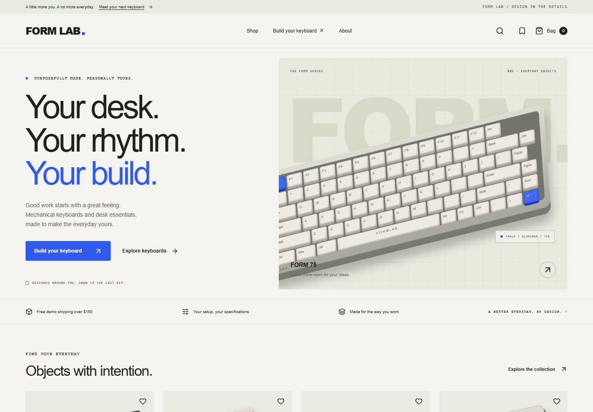

<div align="center">

# FORM LAB

### Build your everyday masterpiece.

A mechanical keyboard storefront connecting product discovery, compatible custom builds, and a complete demo checkout.

[Live Demo](https://form-lab-kappa.vercel.app/) · [Explore the Collection](https://form-lab-kappa.vercel.app/shop) · [Open the Build Lab](https://form-lab-kappa.vercel.app/build)

**React 19 · TypeScript · Vite · Tailwind CSS v4 · React Three Fiber**

</div>



## Overview

FORM LAB is an original, fictional keyboard and desk-accessory brand built as an interactive commerce portfolio project. Its central challenge is making a technical purchase understandable: visitors can compare products, choose a layout and typing feel, resolve incompatible parts, review the full price, and carry that configuration through checkout.

The application runs without accounts, API keys, or a backend. Products are deterministic fixtures, purchasing is explicitly simulated, and browser storage keeps the experience usable across refreshes.

## Explore the experience

| Experience        | What works                                                                                                                                                                                  |
| ----------------- | ------------------------------------------------------------------------------------------------------------------------------------------------------------------------------------------- |
| Product discovery | Search, URL-synchronized filters, sorting, availability controls, mobile filter drafts, and comparisons of up to three products in the same category.                                       |
| Product detail    | Studio imagery, named finishes, variant-specific prices and stock, quantity controls, compatibility information, and related products.                                                      |
| Keyboard builder  | Six editable stages: **Layout → Case → Switches → Keycaps → Accessories → Review**. Conflicts show explanations, compatible replacements, and the price difference before applying changes. |
| Visual preview    | Procedural 2D plus optional interactive 3D with rotation, zoom, reset, and assembled/exploded views.                                                                                        |
| Saved builds      | Named builds, editing, duplication, removal with undo, local autosave, and versioned configuration share links.                                                                             |
| Shopping bag      | Persistent variants and complete build snapshots, quantity changes, removal with undo, and editing a specific build independently of other lines.                                           |
| Demo checkout     | Guest contact/address validation, order review, current-fixture revalidation, and a local confirmation page that survives refreshes. No card form or payment collection.                    |

### The collection

**116 products across seven categories**, with individual signature palettes and named options:

| Keyboards | Keycaps | Switch packs | Desk mats | Wrist rests | Cables | Bundles |
| --------: | ------: | -----------: | --------: | ----------: | -----: | ------: |
|        24 |      24 |           18 |        16 |          12 |     12 |      10 |

Product imagery combines original generated studio assets with runtime color treatments. Images are illustrative; product specifications and selected options define the demo item. The builder uses deterministic geometry rather than generated photos to represent the configured layout.

## Engineering decisions

### Compatibility belongs in the domain

Pure TypeScript functions define case/PCB systems, MX socket compatibility, keycap coverage, required key sizes, accessory dimensions, switch-pack quantities, stock checks, and bills of materials. These rules are independent of React components.

| Layout | Seeded keys | Switch packs required | Foundation system |
| ------ | ----------: | --------------------: | ----------------- |
| 65%    |          68 |                2 × 35 | FORM-65           |
| 75%    |          82 |                3 × 35 | FORM-75           |
| TKL    |          87 |                3 × 35 | FORM-TKL          |

Prices use integer cents. Pack quantities use ceiling division. A proposed change that invalidates another component requires explicit acceptance of the replacement build and its new total.

### A build is more than a cart label

Configured cart lines preserve the selected parts and pricing snapshot. Configuration identity determines merging; stable line identifiers make editing target the intended item. Revalidation checks current fixture prices, compatibility, and aggregate switch stock before creating a demo order.

Persisted state passes Zod validation. Schema recovery handles malformed data and an explicit version-zero migration. Share URLs use a separate versioned configuration format. Ephemeral camera state stays out of saved builds and links.

### 3D enhances an ordinary HTML flow

The Three.js feature loads only when requested. It uses demand rendering, capped device pixel ratio, bounded controls, Suspense, an error boundary, and a context-loss fallback. Camera changes update the existing canvas. Both preview paths share layout geometry, seeded key counts, and a 6.25u spacebar.

Product choices, prices, and checkout remain available without WebGL. Reduced-motion users start with the 2D experience.

### Accessibility is part of the interaction model

Semantic landmarks, a skip link, visible keyboard focus, named swatches, native modal dialogs, focus restoration, inline errors, and status announcements support keyboard and assistive-technology use. Mobile filter changes remain drafts until applied. Responsive layouts have been checked at **360, 390, 768, 1024, and 1440 px**.

Automated accessibility scanning supports these checks; it does not establish complete WCAG conformance.

## Technology

| Layer               | Tools                                                |
| ------------------- | ---------------------------------------------------- |
| Application         | React 19, strict TypeScript, React Router 7          |
| Build and styling   | Vite 8, Tailwind CSS 4, custom design tokens and CSS |
| Client state        | Zustand 5 with schema-validated local persistence    |
| Forms and contracts | React Hook Form 7, Zod 4, resolver integration       |
| Motion and 3D       | Motion, Three.js, React Three Fiber, Drei            |
| Quality             | Vitest, Playwright, axe-core, ESLint, Prettier       |
| Image preparation   | Sharp; local WebP assets                             |
| Hosting             | Vercel static SPA deployment                         |

Dependency versions are pinned in `package.json` and resolved in `package-lock.json`.

## Getting started

Use **Node.js 22.12+** and npm.

```bash
git clone https://github.com/dongyunkim96/FormLab.git
cd FormLab
npm ci
npm run dev
```

Open the URL printed by Vite, normally [http://localhost:5173](http://localhost:5173).

**No environment variables are required.** `.env.example` documents the demo-mode convention; the current application always uses the local demo implementation. Setting a variable does not enable payments or cloud services. Never place secrets in `VITE_` variables, which are exposed to the client bundle.

### Commands

| Command             | Purpose                                            |
| ------------------- | -------------------------------------------------- |
| `npm run dev`       | Start the development server.                      |
| `npm run typecheck` | Run the TypeScript project check.                  |
| `npm run lint`      | Run ESLint.                                        |
| `npm test`          | Run the domain test suite.                         |
| `npm run test:e2e`  | Run the Chromium browser journeys.                 |
| `npm run build`     | Type-check and produce the static site in `dist/`. |
| `npx vite preview`  | Serve the production build locally.                |

Install the browser once before running end-to-end tests:

```bash
npx playwright install chromium
npm run test:e2e
```

Playwright starts the development server or reuses a running instance on port 5173. For custom Windows browser installations, set `PLAYWRIGHT_BROWSERS_PATH` to that directory. Failed browser tests retain screenshots and traces in the ignored `test-results/` directory.

## Verification

The repository includes **16 domain tests and 12 browser journeys**.

- **Domain coverage:** compatible defaults, exact geometry, switch-pack rounding, integer money, catalog integrity and unique category finishes, configuration round trips, malformed imports, persistence migration/recovery, cart identity after edits, quantity limits, and aggregate stock.
- **Browser coverage:** discovery/back navigation, variant persistence, new-product purchasing, build sharing and conflict resolution, independent cart-build edits, saved-build editing/undo, validated checkout and durable receipts, mobile filters, 3D controls, reduced motion, WebGL failure, keyboard interactions, accessibility scans, failed assets, and responsive overflow.

Build, lint, and domain checks passed during implementation. Browser journeys were verified during development, with targeted reruns after catalog and image changes. See [verification notes](docs/verification.md) for the tested scope and environment; there is no implied CI status or exhaustive production audit.

The optional 3D chunk currently produces a bundle-size warning, approximately **938 kB minified / 248 kB gzip**. It is deferred until enabled. Historical performance observations predate later catalog changes and are local lab results, not field Core Web Vitals or production guarantees.

## Project structure

```text
src/
├── domain/
│   ├── catalog.ts          # Products, variants, money, repository contract
│   ├── catalog-details.ts  # Product specifications and signature palettes
│   ├── builder.ts          # Compatibility, pricing, configuration sharing
│   ├── geometry.ts         # Shared keyboard layout geometry
│   ├── store.ts            # Cart, builds, wishlist, orders, persistence
│   └── domain.test.ts      # Domain regression coverage
├── pages/                  # Home, shop, product, builder, saved, cart, checkout
├── ui/                     # Shared controls, photo treatment, 2D/3D previews
├── App.tsx                 # Routes, navigation, dialogs, route metadata
└── styles.css              # Brand tokens, layouts, responsive styling
tests/                      # Playwright journeys and axe-core scans
public/                     # Local images and favicon
scripts/                    # Image preparation and lab measurement utilities
docs/                       # Architecture, assets, tooling, verification
```

## Routes and deployment

| Route                      | Page                                           |
| -------------------------- | ---------------------------------------------- |
| `/`                        | Brand homepage                                 |
| `/shop`                    | Searchable, filterable collection              |
| `/products/:slug`          | Product details and variant selection          |
| `/build`                   | Keyboard configurator and shared-build imports |
| `/saved`                   | Local builds and saved products                |
| `/cart`                    | Shopping bag                                   |
| `/checkout`                | Demo guest checkout                            |
| `/orders/:publicReference` | Local demo receipt                             |
| `/about`                   | Brand concept and project context              |

The live application is hosted at **[form-lab-kappa.vercel.app](https://form-lab-kappa.vercel.app/)**. The build command is `npm run build`, and the output directory is `dist`. A static host must serve `index.html` for client-side routes; configure an SPA fallback when deploying elsewhere.

Route titles and canonical links update in the browser. This is a client-rendered SPA with base social metadata, not server-rendered product SEO or individual server-generated social previews.

## Demo boundaries

- **No real commerce:** products, stock, reviews, shipping policies, and orders are fictional. No payments are collected, no emails are sent, and no goods ship.
- **Browser-local data:** current builds, named builds, wishlist, cart, and orders use `localStorage`. They do not sync across devices; clearing site data removes them.
- **Contact data:** names and addresses are validated but not retained. Demo receipts retain the supplied email locally. Use fictional details when exploring checkout.
- **Local receipts:** order references work only in the browser holding that order. Shared build URLs contain configuration choices, not customer information.
- **Estimates:** demo shipping is $9 below $150 and free at or above $150. Tax is not collected. Cart contents are not inventory reservations.

A real commerce integration would require authoritative server pricing and compatibility checks, transactional inventory protection, order ownership enforcement, hosted payment sessions, and signature-verified, idempotent webhooks. Those services are intentionally outside the implemented demo.

## Further reading

- [Architecture](docs/architecture.md) — domain boundaries, state, rendering, and future service integration.
- [Verification](docs/verification.md) — checks performed, environments, and remaining limits.
- [Asset provenance](docs/assets.md) — generated imagery, procedural models, color treatments, and licensing notes.
- [Tooling](docs/tooling.md) — development tools actually used.

FORM LAB is an original portfolio brand. Third-party packages retain their respective licenses; asset provenance is documented separately. This repository does not currently declare a project-wide open-source license.
